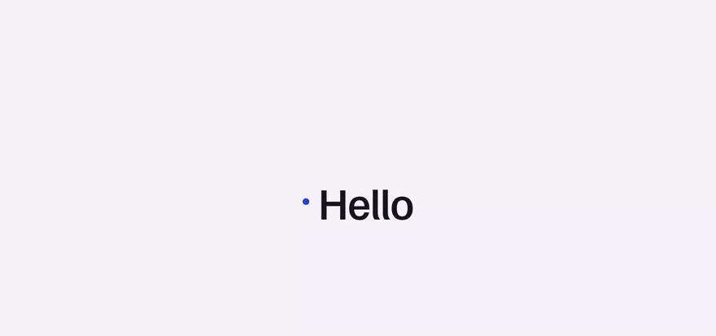
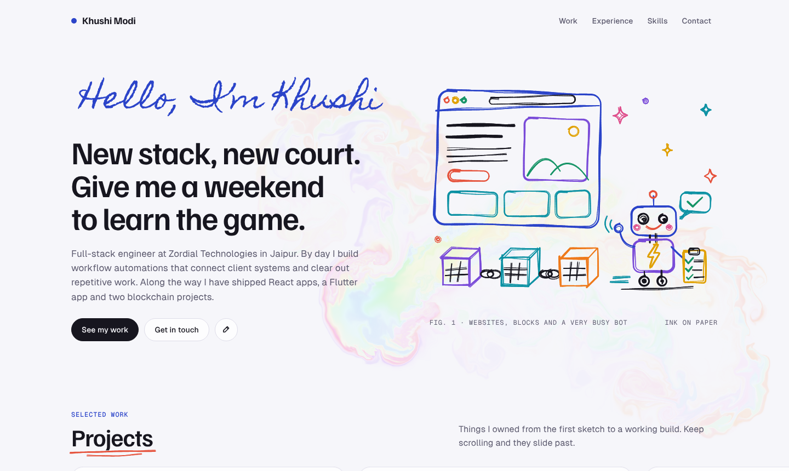
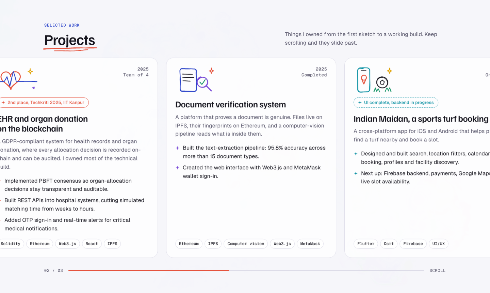
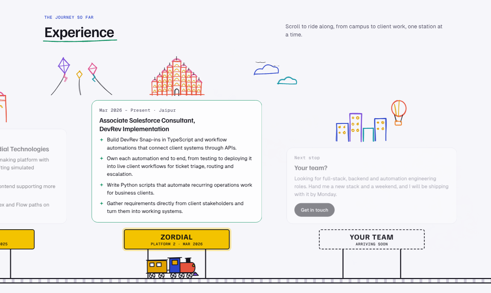
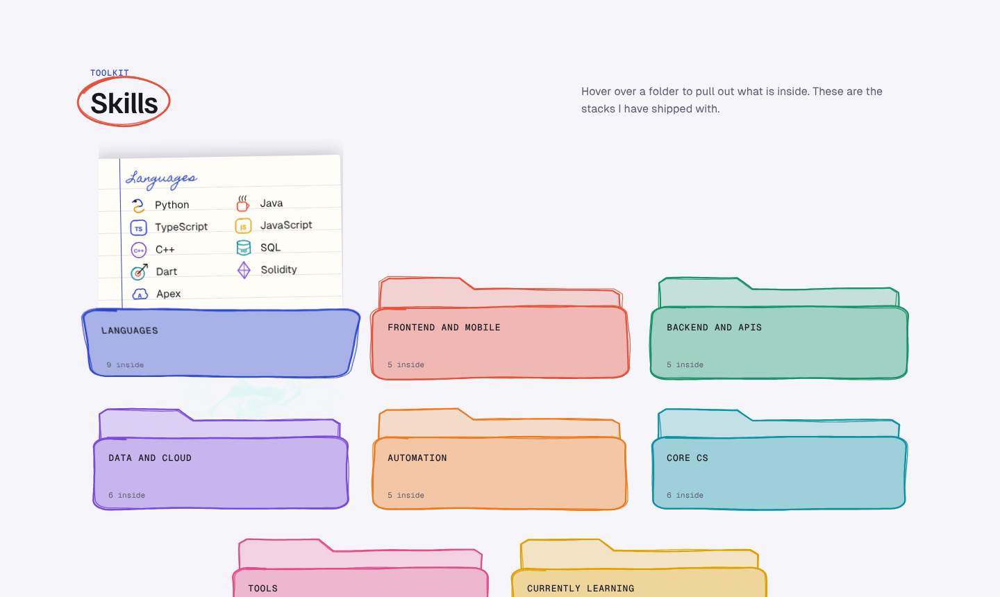
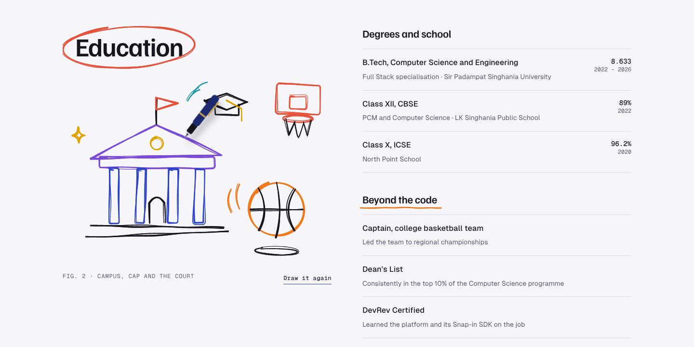

<div align="center">

# Khushi Modi · Portfolio

**A hand-drawn, animated personal site where a fountain pen writes the greeting, sketches the doodles and ink follows your cursor.**

<!-- After deploying, replace the line below with your Vercel link, e.g. **[View the live site →](https://your-site.vercel.app)** -->
**Live site:** _coming soon_




<sub>The hero drawing itself (shown at 2× speed)</sub>

</div>

---

## Highlights

- **Every animation is written from scratch.** There are no animation, canvas or WebGL libraries; the only dependencies are Next.js, React and the fonts.
- **Real fluid simulation.** The ink behind the cursor is a GPU fluid solver written in GLSL, not a particle effect.
- **Handwriting that is actually written.** Letters are thinned to their centre lines and traced stroke by stroke, so the pen follows the shape of each letter.
- **Hand-drawn but deterministic.** Every doodle wobbles as if a person drew it, yet a seeded random generator makes it come out identical on the server and in the browser.
- **Content is separate from code.** All text lives in one file, so updating the site never means touching a component.

## A tour of the site

| | |
|---|---|
|  | **Hero.** A pen writes the greeting, then draws a website, a chain of blockchain blocks and a busy little bot. Moving the mouse leaves a trail of swirling ink that fades after about 1.5 seconds. |
|  | **Projects.** Vertical scrolling moves the cards sideways, each with its own sketched icon and a progress bar. |
|  | **Experience as a train journey.** The train rolls from station to station as you scroll, easing in and pausing at each one. Landmarks along the real route (Udaipur, the Thar, Jaipur's Hawa Mahal) come alive: kites sway, birds fly, clouds drift. |
|  | **Skills in folders.** Hover over a folder and a ruled notepad sheet rises out of it, listing each skill with its own doodled logo. |
|  | **Education.** The pen sketches the campus, a graduation cap and the basketball court, and the ball keeps dribbling once it is drawn. |

The intro curtain greets visitors in twelve languages before lifting, and every drawing can be replayed with its "Draw it again" button.

## Tech stack

| Area | What it uses |
|---|---|
| Framework | **Next.js 16** (App Router, statically prerendered) · **React 19** |
| Language | **TypeScript** in strict mode |
| Ink background | **WebGL** + hand-written **GLSL** shaders (stable-fluids solver) |
| Pen and doodles | **Canvas 2D** + **SVG**, driven by `requestAnimationFrame` |
| Scroll effects | `position: sticky`, `IntersectionObserver`, `ResizeObserver` |
| Styling | Plain **CSS** with custom properties for light and dark themes |
| Fonts | Self-hosted with **Fontsource**: Familjen Grotesk, Geist Sans, Geist Mono, Homemade Apple |
| Hosting | **GitHub Pages** via GitHub Actions (Vercel or any static host also works) |

## Run it locally

You need **Node.js 20.9 or newer**.

```bash
git clone https://github.com/khushi107/khushi-portfolio.git
cd khushi-portfolio
npm install
npm run dev        # http://localhost:3000
```

| Command | What it does |
|---|---|
| `npm run dev` | Development server with hot reload |
| `npm run build` | Production build |
| `npm start` | Serve the production build |
| `npm run typecheck` | Type-check without building |

## Make changes

| To change… | Edit |
|---|---|
| Any text: headline, projects, stations, skills, education, contact | `data/profile.ts` |
| Pen speed, intro timing, ink trail length, swirl, brush size, colours | `lib/config.ts` |
| A drawing | `lib/doodles/` (one file per scene) |
| Colours and fonts for both themes | `styles/tokens.css` |

## Project structure

```
app/
  layout.tsx            fonts, metadata, global styles
  page.tsx              puts the sections together
components/
  intro/                IntroProvider (shared intro state), IntroCurtain
  fluid/                FluidBackground (mounts the WebGL simulation)
  drawing/              Pen, PinnedScroll, SketchMark, SketchIcon, SkillIcon, Folder
  journey/              Train, Sky (railway pieces)
  sections/             Hero, Projects, Journey, Skills, Education, Contact
  layout/               Header, Footer
lib/
  config.ts             animation settings
  browser.ts            font loading and resize/theme helpers
  fluid/                FluidSimulation (WebGL engine) and its GLSL shaders
  pen/                  the pen engine, handwriting, drawing operations
  sketch/               geometry, sketchify (hand-drawn look), seeded RNG, draw-on
  doodles/              the drawings: hero, campus, sky, project and skill icons
data/
  profile.ts            all site content
styles/
  tokens.css            colours and fonts for light and dark themes
  base.css, intro.css, sections.css, skills.css
docs/screenshots/       images used in this README
.github/workflows/      deploy.yml: builds and publishes to GitHub Pages
```

**Design principle:** React owns structure and content; animation runs in plain TypeScript engines in `lib/`, driven by `requestAnimationFrame`. A component creates its engine in `useEffect`, hands it DOM refs and cleans it up on unmount. Per-frame updates write to the DOM directly instead of setting React state, so scrolling and drawing never cause re-renders.

## How each effect works

<details>
<summary><b>Intro curtain</b> · <code>components/intro/IntroCurtain.tsx</code></summary>

<br>

A timer cycles twelve greetings (160 ms each, the first held for 900 ms). Then the curtain lifts with `requestAnimationFrame`, while its bottom edge, an SVG quadratic Bézier, flattens from a deep curve to a straight line. Shared state in `IntroProvider` tells the rest of the page when the curtain starts lifting (`revealed`) and when it is gone (`finished`), so the pen starts drawing at the right moment.

</details>

<details>
<summary><b>Ink that follows the cursor</b> · <code>lib/fluid/</code></summary>

<br>

A real-time fluid simulation on the GPU using WebGL and GLSL shaders, following Jos Stam's *Stable Fluids* method. Each frame runs these passes:

1. **Splat:** pointer movement adds a Gaussian blob of colour (dye) and force (velocity). The colour cycles through every hue as you move.
2. **Curl and vorticity confinement:** measure how the fluid spins and push it to keep small swirls alive (the `swirl` setting).
3. **Divergence and pressure:** 20 Jacobi iterations solve for pressure.
4. **Gradient subtraction:** removing the pressure gradient keeps the fluid incompressible.
5. **Advection:** velocity and dye are carried along the flow, and both decay slightly. The dye decay rate sets how quickly the page clears after you stop moving (about 1.5 s).

Textures are half-float and ping-pong between two framebuffers. The display shader outputs premultiplied alpha, so faint ink tints the page instead of greying it.

</details>

<details>
<summary><b>Handwriting</b> · <code>lib/pen/handwriting.ts</code></summary>

<br>

The greeting is written stroke by stroke, not wiped in:

1. Render the text in *Homemade Apple* on a hidden canvas at 2× resolution.
2. **Zhang–Suen thinning** reduces each letter to a one-pixel centre line.
3. A **chamfer distance transform** measures how thick the letter is at each point.
4. The centre lines are **traced into ordered strokes**, written left to right.
5. As the pen moves, it stamps circles (as wide as the letter at that point) into a mask. The visible text is the font drawn `source-in` through that mask, so the finished result looks exactly like the font.

</details>

<details>
<summary><b>The pen and the doodles</b> · <code>lib/pen/drawer.ts</code>, <code>lib/sketch/</code>, <code>lib/doodles/</code></summary>

<br>

Doodles are defined as simple geometry (lines, Bézier curves, ellipses, rounded boxes, sparkles, a gear, a parametric heart) in their own design space, then scaled into place.

The hand-drawn look comes from `sketchify`:

- `wonk()` tilts each shape by up to ±2° and stretches it by up to ±3%.
- Every point is offset along the line's normal by two slow sine waves, so lines drift rather than jitter.
- Line ends overshoot slightly, like a quick pen stroke.
- A second, lighter pass is drawn slightly offset, like going over a line twice.
- Line width varies along the stroke to mimic pen pressure.

A seeded random generator (mulberry32) makes every drawing identical each time it is drawn.

The drawer moves an SVG fountain pen at a constant speed (420 px/s), lifts it between strokes and tilts it with the direction of travel. Each frame it spends a time budget along the list of drawing operations. The loop has a hard iteration cap and always uses up the frame's time, so it can never stall the page.

**Layers that keep moving:** a stroke can name a canvas layer to draw on. The basketball and its shadow are drawn on their own canvases, so once the pen finishes, CSS keyframes make the ball dribble a few pixels. It squashes slightly where it meets the ground, while the shadow shrinks and fades as the ball rises.

</details>

<details>
<summary><b>Hand-drawn circles and underlines</b> · <code>components/drawing/SketchMark.tsx</code></summary>

<br>

Circles and underlines on headings measure their text, build a sketchy SVG path around it, and draw themselves the first time they scroll into view, using `IntersectionObserver` and the `stroke-dasharray` / `stroke-dashoffset` technique.

</details>

<details>
<summary><b>Sideways scrolling</b> · <code>components/drawing/PinnedScroll.tsx</code></summary>

<br>

The section is made exactly as tall as its horizontal overflow, and its contents are pinned with `position: sticky`. Scroll progress (0 to 1) through the section moves the track sideways. A `ResizeObserver` re-measures when content or fonts change size.

</details>

<details>
<summary><b>The railway</b> · <code>components/sections/Journey.tsx</code></summary>

<br>

Scroll progress is split into legs between stations. Each leg is eased (cubic in-out) with a pause at both ends, so the train stops at every station. A camera keeps the train about a third of the way across the screen. The wheels rotate by distance travelled divided by their radius, stations light up on arrival, and smoke puffs only while the train is moving.

The landmarks trace the real route, from Udaipur's lake palace over SPSU, through the Thar dunes, to Jaipur's city gate and Hawa Mahal. Each one is sized to the free space above its own card and sketches itself as it slides into view. Then CSS keyframe animations on separate SVG groups bring them to life: the lake ripples, birds flap across, the flag flutters, kites sway from their strings, clouds drift and the hot-air balloon bobs. Each part has its own duration and a negative delay, so nothing moves in sync.

</details>

<details>
<summary><b>Skill folders</b> · <code>components/sections/Skills.tsx</code>, <code>components/drawing/Folder.tsx</code></summary>

<br>

Each category is a hand-drawn folder in two layers, a back with a tab and a front flap, laid out in rows of 3, 3 and 2 on a six-column grid. All folders start closed. Hovering, tapping or focusing one tips its flap forward with a CSS 3D rotation and a ruled notepad sheet rises out of it; moving away (or tapping elsewhere on a phone) slides the sheet back in. The component keeps two pieces of state: `active`, the open folder or `null`, and `shown`, the sheet on screen, which stays mounted while it plays its closing animation.

The stacking order is deliberate: folder backs, then the other folders' fronts, then the sheet, then the open folder's front. So the sheet covers the row above but still looks like it comes out of its own folder. A clipping container ends at the folder's middle and is kept in place by a `ResizeObserver`. A folder hidden behind the sheet ignores hover, so the sheet never flickers, but still opens on click. Every skill has its own doodled logo, sketched in one after another as the sheet rises. The folders form an ARIA tab list, so they work with the keyboard too.

</details>

## Accessibility and performance

- The page is **statically prerendered**, so content appears before any JavaScript runs.
- The greeting is also present as screen-reader text, and decorative drawings are `aria-hidden`.
- Keyboard focus is visible, and the intro can be skipped with a click, Escape, Enter or Space.
- Colours are defined for both light and dark themes.
- The fluid's velocity is solved on a small 128-cell grid, with a finer grid only for the colour, so it stays smooth on ordinary laptops.

## Deploy

The site builds to static HTML, so it can be hosted anywhere.

- **GitHub Pages:** already set up. The workflow in `.github/workflows/deploy.yml` builds a static export and publishes it on every push to `main`. Turn it on once under **Settings → Pages → Source: GitHub Actions**. `next.config.ts` adds the repository name as a path prefix (`username.github.io/portfolio`), or none for a repository named `username.github.io`.
- **Vercel:** import the GitHub repository at [vercel.com/new](https://vercel.com/new). Next.js is detected automatically, and every push to `main` redeploys the site.
- **Netlify:** build command `npm run build`.

## Credits

- Effects inspired by [aaabadcode.com](https://www.aaabadcode.com/) (cursor ink), [aadarshrai.vercel.app](https://aadarshrai.vercel.app/) (multilingual intro) and [markodenic.com](https://markodenic.com/) (pen-drawn hero).
- The fluid solver follows Jos Stam's *Stable Fluids* (SIGGRAPH 1999) and the approach popularised by Pavel Dobryakov's WebGL Fluid Simulation.
- Fonts are licensed under the SIL Open Font License.

## Contact

**Khushi Modi** · [khushi85449@gmail.com](mailto:khushi85449@gmail.com) · [LinkedIn](https://www.linkedin.com/in/khushi-modi-1846b8309) · [GitHub](https://github.com/khushi107)
